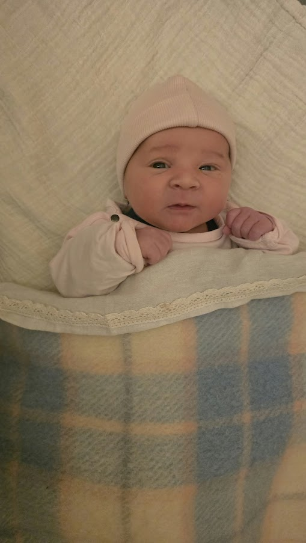

# Theo Armour / Collection README

_My granddaughter, born October 3, 2026: A good reason why it to do this sort of thing._

https://theo-armour.github.io/collection is a GitHub repository intended to be the starting point for an extensive collection of my personal and family "things".

## Purpose of this Repository

* Document and sharing the process of creating a template and enabling of online collections
* Serve as a central hub for managing, maintaining, and sharing the collection.
* Act as a repository from which the material can be accessed and utilized.
* Act as a catalog for links to the collected items in other locations
* Provide a structured and searchable curation of the collection.

## Current Status

The repository is currently in the early stages of development. 

I'm in the process of creating a request for proposal (RFP) for the collection project. The RFP will be sent to members of the the various societies of archivists. 

The RFP itself is in its own folder: [RFP-draft](RFP-draft/). This folder includes the initial ideas, requirements, and considerations for the RFP.

The RFP refers to RFP supplemental information, which is currently here:

## RFP Supplementary Information

The request for proposal indicates that there is a link to a web page with more information. This is the web page with the supplementary information. 

## About Theo

See: https://theo-armour.github.io/

"You can see everything" about me here. ;-)

## Armour _et al_ Genealogy

See: https://theo-armour.github.io/genealogy/

Very much a work in progress. 

* Documents family history and lineage.
* Maintains records of family members and their relationships.
* Provides a structured and searchable archive of genealogical information.
* Provides evidence of the possible notability of relevant family members For drafting future articles for Wikipedia 

On Wikipedia, notability is a test used by editors to decide whether a given topic warrants its own article.

See https://en.wikipedia.org/wiki/Wikipedia:Notability

## San Francisco Ladies Protection and Relief Society

https://sflprs.github.io/ has recently come online. I'm still working out interesting ways of presenting all this information. There is much more to be added that I've already put online elsewhere, But should be consolidated in a single location like such as this one. 

See:

* https://sflprs.github.io/
* https://en.wikipedia.org/wiki/San_Francisco_Ladies_Protection_and_Relief_Society

The San Francisco Ladies Protection and Relief Society is the owner and operator of Heritage on the Marina, the retirement community for the elderly that has been my home since August 5, 2020.

I'm involved in the creation, maintenance and updating of the contributions noted above. I'm also the tenant-elected representative to the board of directors of the Society. 

## Julia Morgan Building

See:
* https://Julia-Morgan-Building.github.io
* https://en.wikipedia.org/wiki/Julia_Morgan_Building

A significant building on the Heritage on the Marina property is the Julia Morgan Building. 

I'm involved in the creation, maintenance and updating of two of the above contributions. 

The GitHub repository with much material is under construction, But should be online shortly 

## EverEverLand

An ongoing personal effort I started over 20 years ago. It's one of my major efforts. Here are two links to two different aspects of the project: website and source code.

### EverEverLand (2022)

* https://evereverland.com or https://evereverland.github.io/
* https://github.com/evereverland

### EverEverLand 2019

* https://evereverland.github.io/2019 ~ earlier views of EverEverLand
* https://github.com/evereverland/2019
* https://evereverland.github.io/2019/#everlandings/README.md ~ Online archival collections of the efforts of different family, friends and acquaintances

## Personal Items

A significant part of the effort will be getting high-quality images of all of the following items: art collection, furniture, and personal items. 

### Art Collection

* https://evereverland.github.io/2019/#everlandings/theo-armour/README.md

### Furniture and Personal Items

See [Hobart Appraisal Update 2024](https://drive.google.com/file/d/1ErPPqu1MZmlFBbtBGNv6Hy6s8zPIF1uj/view?usp=sharing)

## Change Log

### 2026-10-27

Add further detail on the organization and structure of the collection, including updates to the RFP and supplemental information. 

### 2026-10-25

Cleaning up the text, adding a few more notes, and fixing a few bugs 

### 2026-10-23

* Significant update on file structure and organization.
* Update on the visibility of objects in the GitHub Pages website 

