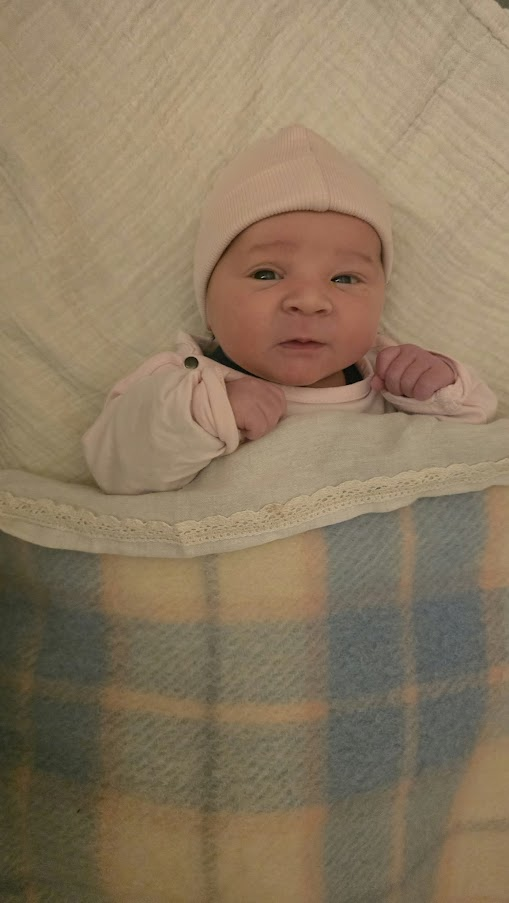

# Theo Armour / Collection README

 

_My granddaughter, born October 3, 2026: A good reason why to do this sort of thing._

https://theo-armour.github.io/collection is a GitHub repository intended to be the starting point for an extensive collection of my personal and family "things".

## Purpose of this Repository

* Document and share the process of creating a template and enabling of online collections
* Serve as a central hub for managing, maintaining, and sharing the collection
* Act as a repository from which the material can be accessed and utilized
* Act as a catalog for links to the collected items in other locations
* Provide a structured and searchable curation of the collection

## Current Status

The repository is currently in the early stages of development.

**2026-11-26** Major update to the content. In particular, have a look at the Notes to Reader folder.

Having completed the Seeking Archivist RFP and received eight delightful replies, it is now time to start meeting with the archivists. I have drafted an agenda, which you can read here: [First-Meeting-Agenda](https://theo-armour.github.io/collection/#First-Meeting-Agenda/README-First-Meeting-Agenda.md).

**2026-11-17** I sent a short email to the West_Arch mailing list seeking an experienced personal archivist for a paid initial assessment of my family and personal papers. The text of the email is here: [Seeking-Archivist-RFP.md](https://theo-armour.github.io/collection/#Seeking-Archivist-RFP/2026-11-17-Seeking-Archivist-RFP.md).

The request is deliberately narrow: an assessment of the papers, with a phased plan and cost estimate. The rest of this page describes the wider collection. It is background for the assessment and possible material for later phases, not part of the current request.

Earlier, longer drafts of the request for proposal (RFP) are in [Seeking-Archivist-RFP/RFP-draft](https://theo-armour.github.io/collection/#Seeking-Archivist-RFP/RFP-draft/README.md).

Please note: this and other pages on this website are likely to change frequently. And because this page is maintained on GitHub, every single "push" is recorded in the history of this repository.

## Supplementary Information

The Seeking Archivist RFP email links to this page for more about the collection. This is that page.

## About Theo

See: https://theo-armour.github.io/

"You can see everything" about me here. ;-)

This repository provides access to the sorts of things I've been doing in the most recent third of my life, in other words, everything here is online. Managing and curation of these higgledy-piggledy efforts is a possible later phase.

## Changing the World

I’ve spent my life in the headline business. In architecture we called them renderings. In software we called them demos.

["I have changed the world three times."](https://theo-armour.github.io/collection/#Seeking-Archivist-RFP/changing-the-world.md)

## Armour _et al_ Genealogy

See: https://theo-armour.github.io/genealogy/

Very much a work in progress.

* Documents family history and lineage.
* Maintains records of family members and their relationships.
* Provides a structured and searchable archive of genealogical information.
* Provides evidence of the possible notability of relevant family members for drafting future articles for Wikipedia

On Wikipedia, notability is a test used by editors to decide whether a given topic warrants its own article.

See: https://en.wikipedia.org/wiki/Wikipedia:Notability

In my book, everybody is notable. If there is a right to be forgotten, then there also must be a right to be remembered. Even so, I kind of enjoy looking up the ones that had fun, engaging, and perhaps therefore more notable lives.

I have put some of them in a list here that I call "Peeps in My Family".

See: https://theo-armour.github.io/genealogy/#Peeps-in-My-Family.md

Much of the information stored in the bank boxes in my storage locker is about these people. These papers are the subject of the current request. Linking the primary and secondary source items in storage to these people is the first step in establishing a comprehensive archival record.

## San Francisco Ladies Protection and Relief Society

https://sflprs.github.io/ has recently come online. I'm still working out interesting ways of presenting all this information. There is much more to be added that I've already put online elsewhere, But should be consolidated in a single location like such as this one.

See:

* https://sflprs.github.io/
* https://en.wikipedia.org/wiki/San_Francisco_Ladies_Protection_and_Relief_Society

The San Francisco Ladies Protection and Relief Society is the owner and operator of Heritage on the Marina, the retirement community for the elderly that has been my home since August 5, 2020.

I'm involved in the creation, maintenance and updating of the contributions noted above. I'm also the tenant-elected representative to the board of directors of the Society.

A good number of my current efforts are about archiving things. Establishing and sharing good practices for doing this sort of thing is part of the wider project, not the current request.

## Julia Morgan Building

See:
* https://Julia-Morgan-Building.github.io
* https://en.wikipedia.org/wiki/Julia_Morgan_Building

A significant building on the Heritage on the Marina property is the Julia Morgan Building.

I'm involved in the creation, maintenance and updating of two of the above contributions.

The GitHub repository with much material is under construction, but should be online shortly.

The retirement community I live in includes the Julia Morgan building. We are in the process of affiliating with Sequoia Living. The campus will undergo a huge renovation, and I will be very much part of that. A good part of the effort will be the curation of what we know about Julia Morgan and her involvement with this building, and more. This is a separate effort and not part of the current request.

## EverEverLand

An ongoing personal effort I started over 20 years ago. It's one of my major efforts. Here are two links to two different aspects of the project: website and source code. Considering ways of embellishing and curating this effort is a possible later phase.

### EverEverLand (2022)

* https://evereverland.com or https://evereverland.github.io/
* https://github.com/evereverland

### EverEverLand 2019

* https://evereverland.github.io/2019 ~ earlier views of EverEverLand
* https://github.com/evereverland/2019
* https://evereverland.github.io/2019/#everlandings/README.md ~ Online archival collections of the efforts of different family, friends and acquaintances

## Personal Items

A significant part of the effort will be getting high-quality images of all of the following items: art collection, furniture, and personal items.

For just about every item in each of these collections here, I have a story to tell. A picture creates a thousand memories, or something. In other words, a picture is just as good as seeing the object itself for many of the purposes that I plan to use these images for.

Of course, the picture does not have the "aura" as described by Walter Benjamin. The unique presence and authenticity of the original object cannot be fully captured in an image.

Nonetheless, by giving my story about the object and then making the physical item available to collectors of the future, I can provide a richer context and preserve the legacy of the source items for posterity. And so, dealing with these items themselves is a possible later phase.

### Art Collection

* https://evereverland.github.io/2019/#everlandings/theo-armour/README.md

### Furniture and Personal Items

See [Hobart Appraisal Update 2024](https://drive.google.com/file/d/1ErPPqu1MZmlFBbtBGNv6Hy6s8zPIF1uj/view?usp=sharing)

## Websites

I used to maintain dozens of websites with their own .com URLs. Now almost all of my websites point to WordPress.com websites or to GitHub Pages websites.

There are still some websites left on Dreamhost and Bluehost servers that I have not yet brought over to GitHub or wherever, so that effort is part of the whole archiving project.

## Conclusion

The priority of this proposal is the digitization of all paper documents and physical objects. The subsequent phases will involve organizing, cataloging, and providing context for these materials and the already digital materials to create a comprehensive archival record.

## Change Log

### 2026-11-23

* Major update to the content management app, TooToo, that runs all of this
* Used Claude to do more proofreading.

### 2026-11-17

* Email seeking an archivist sent to the West_Arch mailing list
* Current Status updated; the wider collection is now described as background and later phases, not part of the current request
* Checking links and carrying out minor edits

### 2026-10-30

* Draft RFP 0.2 released to my advisor (and Alix)

### 2026-10-29

* Added correspondence as a visible folder.
* Added text giving reasons why each of the above elements is part of the RFP

### 2026-10-27

AI: Add further detail on the organization and structure of the collection, including updates to the RFP and supplemental information.

I'm reasonably happy with the current status of things. I kind of feel everything is sort of at an 80% good stage. Pareto effect is now kicking in: the 20% more would take a much longer time to complete.

And, of course, I must leave space for the archivists to spin their magic.

New bits include links to : "Peeps-in-My-Family" - which is now up on ./genealogy, Julia Morgan Building on GitHub and more.

### 2026-10-25

Cleaning up the text, adding a few more notes, and fixing a few bugs

### 2026-10-23

* Significant update on file structure and organization.
* Update on the visibility of objects in the GitHub Pages website

