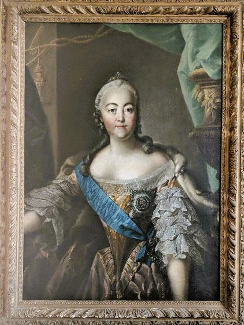

# Armour Collection Archival Assessment and Master Plan

*A request for proposals from Theo Armour, San Francisco*

## ☞ Overview

I'm looking for a Bay Area archivist to assess a large, mixed family and personal collection and write a master plan for it, and then, if we work well together, to lead the work that follows. I have spent my life as a designer. This archive is the design I most want to get right: free and open, useful to future generations, and a small experiment in what archiving and historiography may become in the age of AI.

One item from the collection: 
 
*An 18th-century portrait of Empress [Elizabeth of Russia](https://en.wikipedia.org/wiki/Elizabeth_of_Russia). Her hands are missing because the canvas was cut from its frame when the Koudacheff family escaped St Petersburg in 1918.*

I'd especially welcome a partner who wants to try things: AI-assisted description, open metadata on GitHub, whatever you've wanted to test and never had a client willing to let you.

## ❖ The Collection

* **Extent of documents:** about 200 linear feet, mostly in bank boxes, in two indoor storage units in San Francisco. There are also oversize architectural drawings.
* **Art and objects:** about 30 works of art, several of museum quality, in a separate art storage facility, plus furniture and _objets d'art_. An older appraisal exists.
* **Dates:** 1700s to the present, mostly from the 1970s onward.
* **Formats:** letters, postcards, photographs, slides, negatives, architectural drawings (some large-format), business records, publications, clippings, notebooks, manuals, software, audio, and data media.
* **Born-digital:** files on hard drives, Dropbox, Google Drive, and GitHub. Legacy media is likely in the boxes, extent unknown: floppies, CDs/DVDs, audio and video tapes, and old software such as AutoCAD.
* **Arrangement and condition:** order is quite mixed, with no reliable original order across boxes. There is some room in the units to open boxes. I know of no mold, pests, or water damage, but the survey should confirm this.

**Two threads run through it all.** One is family, with papers connected to [Norman Armour](https://en.wikipedia.org/wiki/Norman_Armour), [George Armour](https://en.wikipedia.org/wiki/George_Armour), [Albert Burrage](https://en.wikipedia.org/wiki/Albert_Burrage), [Walter Lowrie](https://en.wikipedia.org/wiki/Walter_Lowrie_(author)), and the [Koudacheff (Kudashev) family](https://ru.wikipedia.org/wiki/%D0%9A%D1%83%D0%B4%D0%B0%D1%88%D0%B5%D0%B2%D1%8B). The other is my own career, which I half-seriously call "Three Ways Theo Helped Change the World." Whether or not that claim holds up, I believe the ordinary working records of ordinary people deserve keeping. \;\-\)

## ☰ Scope by phase

**Phase 1: Assessment and Master Plan**

An on-site survey with me present as needed, followed by a written plan covering:

* Inventory and condition assessment, at box or series level, with extent by format.
* A recommended arrangement and cataloging approach, including suggested processing levels ([MPLP](https://en.wikipedia.org/wiki/More_Product,_Less_Process)-style where it makes sense) and a simple metadata scheme.
* Digitization priorities, specifications ([FADGI](https://www.digitizationguidelines.gov/) or equivalent), and estimated costs by format.
* A digital preservation and access strategy, following [OAIS](https://en.wikipedia.org/wiki/Open_Archival_Information_System) principles in proportion to a personal archive. It should include an access policy (public / restricted / embargoed) and privacy, copyright, and ownership provisions.
* A phased implementation schedule and budget.

**Phases 2–3: Please describe how you would lead these.**

* **Phase 2, triage and digitization:** an experienced archivist opens boxes, identifies what each item is, and decides where it goes: in-house scanning, specialist digitization, donation, sale, or recycling. Items are batched to the right specialists: sheet-feed scanning, large-format photography, film and slide scanning, AV transfer, disk imaging, object or 3D photography.
* **Phase 3, management and transfer:** a landing zone for files, consistent naming, item or folder-level metadata, and transfer to long-term free homes (Internet Archive, Permanent.org, GitHub) with fixity checks and redundancy. No ongoing hosting costs.
* **Placement:** help approaching Princeton (Norman Armour, Walter Lowrie), the Art Institute of Chicago (George Armour), and institutions interested in Koudacheff material.

## ♟ Roles

* **You lead and coordinate.** You don't need to do everything yourself. I'm hoping for someone with a strong network of specialists.
* **I'm an engaged client.** I'll be present for the survey and available for decisions, but I don't want to be the project manager. I have one hand and am partially paraplegic, so I'm hands-on only up to a point.
* **Credit:** I'm happy for the work to be written up, presented at conferences, and credited to you. The methods will be open too.
* **Disposition:** we agree on rules up front, you apply them, and you bring exceptions to me. Nothing is recycled until I've had a chance to review it.
* **Access:** open by default. You flag sensitive material (third-party correspondence, living people, medical, financial, legal, and confidential business records) and recommend a policy. I make the final calls.
* **Art and objects:** in scope for photography, basic documentation, and finding provenance papers in the boxes. Monetary appraisal, including appraisal of donations for tax purposes, and art placement are referred to qualified appraisers and advisors.
* **Description after digitization:** largely my future responsibility, with human, AI and your help, over the years ahead.

## ✎ Deliverables (Phase 1)

* A written assessment and master plan covering the five Phase 1 items above, in an editable format.
* A short debrief meeting to walk through recommendations.
* A Phase 2–3 cost estimate I can budget against.

## ⚖︎ Budget and terms

* I haven't set a figure. Please estimate Phase 1 as **hours × rate**, showing survey days and report hours separately.
* For Phases 2–3, please include a **rate card**: hourly rates, per-item digitization rates by format, and how specialist costs are billed (pass-through or markup).
* I prefer hourly or per-item pricing to a lump sum, paid in phases or as a retainer. Later phases have no fixed end date.
* Quality over speed.
* Bay Area presence is required for the hands-on work.

## ✓ Selection criteria

* Experience with mixed personal and family collections, including 18th-century, fragile, and oversize material.
* Competence with born-digital and legacy media, directly or through partners.
* A strong specialist network and a record of managing multi-vendor projects.
* Clear, warm, online communication, and interest in open access and in archiving in the age of AI.
* Reasonable, transparent pricing.

## ✐ Proposal requirements

Please send, in any format you like:

* Your approach to Phase 1, and a sample or outline of a comparable assessment report.
* Your Phase 1 estimate (hours × rate) and a Phases 2–3 rate card.
* How you would lead Phases 2–3: your specialists, how you'd coordinate them, and how you'd handle legacy digital media (e.g. write-blocked imaging, BitCurator, AV transfer vendors).
* Relevant experience with family, personal, architectural, or born-digital collections.
* Two or three references.
* Whether Phase 2 would need an off-site workspace, and what it would cost.
* Tell me about the most surprising thing you've found in a box - and what you learned from it.

## ☏ Contact and timeline

* **Contact:** Theo Armour, t.armour@gmail.com, 415 828-0000, theo-armour.github.io
* **Walkthrough:** before you write a proposal, I'm glad to show you the storage units. I'll pay your hourly rate for up to two hours.
* **Proposals due:** November 30, 2026
* **Start:** Early 2027 or upon agreement
* **Phase 1 report:** within 6–8 weeks of the on-site survey

Questions and an early conversation are very welcome. Thank you for reading. I hope this sounds like a project you'd enjoy.

## ✚ Supplemental information

The RFP that will be sent out will include a link to a web page supplemental page with supplemental information. It will include:

* Biographical data of some of my family members
* Photos of the art collection
* A 1992 appraisal of furniture and personal items
* Photos of the storage units
* Personal details of my own life

❧❧❧

 

